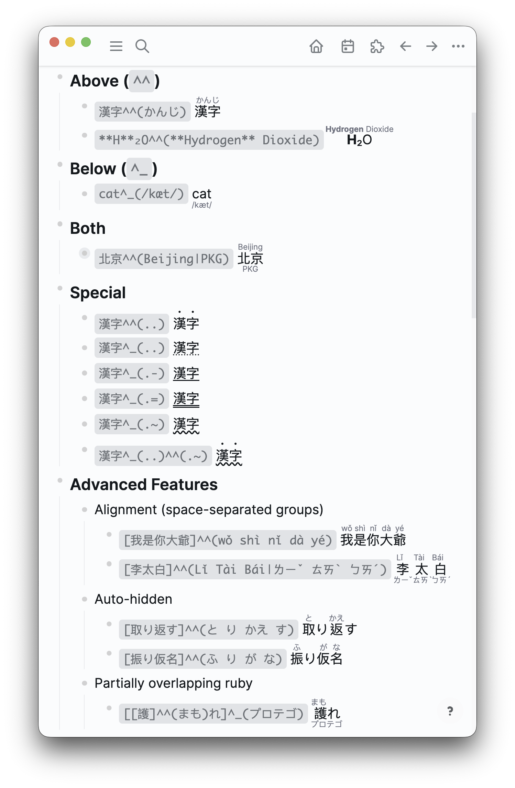

# Inline Annotation for Markdown

Inline Annotation is a small Markdown extension for ruby/furigana, phonetic
guides, interlinear glosses, bouten emphasis dots, overlines, and underlines:

```markdown
[漢字]^^(かんじ)
[base]^^(over)^_(under)
[重要]^^(..)^_(.~)
```

It implements the syntax proposed by Baksi Li in
[Ruby (Furigana) Syntax in Markdown](https://blog.baksili.codes/markdown-ruby).
The original Logseq implementation grew into a shared syntax, reference parser,
and integrations for markdown-it, Obsidian, VS Code, and Logseq.



*The original Logseq showcase. See the [Logseq guide](plugins/logseq/) for
host-specific behavior and copyable examples.*

The syntax is **v2**. The [specification](SPEC.md) defines its grammar, escaping,
source ranges, and rendering contract; the [shared fixtures](fixtures/) keep
implementations aligned. This is a proposal with working implementations.

## Ports and implementations

| Project | Where to get it | Integration |
| --- | --- | --- |
| `markdown-it-inline-annotation` | [npm](https://www.npmjs.com/package/markdown-it-inline-annotation) · [guide](packages/markdown-it/) | Reference parser/model, HTML renderer, and markdown-it plugin |
| Inline Ruby Annotation for Obsidian | [Community directory](https://community.obsidian.md/plugins/inline-annotation) · [guide](plugins/obsidian/) | Reading view and Live Preview |
| Inline Annotation for VS Code | [Marketplace](https://marketplace.visualstudio.com/items?itemName=baksili.vscode-inline-annotation) · [guide](plugins/vscode/) | Built-in Markdown preview |
| `logseq-furigana-ruby` | Logseq Marketplace · [guide](plugins/logseq/) | Logseq renderer, macros, and conversion commands |
| `satteri-inline-annotation` | [Local pilot](packages/satteri/) | Two-phase Sätteri adapter; not published to npm |
| remark/unified | Not implemented | Deferred until a concrete AST pipeline needs it |

## Install

For markdown-it, install the host parser and adapter:

```sh
npm install markdown-it markdown-it-inline-annotation
```

```js
const MarkdownIt = require("markdown-it");
const { inlineAnnotationPlugin } = require("markdown-it-inline-annotation");

const md = new MarkdownIt().use(inlineAnnotationPlugin);
md.render("[漢字]^^(かんじ)");
```

For a parser/model and HTML renderer without markdown-it:

```sh
npm install markdown-it-inline-annotation
```

```js
const {
  findInlineAnnotationModels,
  renderInlineAnnotationsToHtml,
} = require("markdown-it-inline-annotation/core");

const models = findInlineAnnotationModels("[漢字]^^(かんじ)");
const html = renderInlineAnnotationsToHtml("[漢字]^^(かんじ)");
```

`markdown-it` is an optional peer dependency. Core-only consumers do not need
to install it. See the [package guide](packages/markdown-it/) for options,
stylesheet imports, CommonJS/ES module exports, and model APIs.

## Supported syntax

| Input | Meaning |
| --- | --- |
| `[base]^^(ruby)` | Annotation above |
| `[base]^_(gloss)` | Annotation below |
| `base^^(ruby)` | Abbreviated single-token base |
| `[base]^^(over\|under)` | Two-slot annotation |
| `[base]^^(over)^_(under)` | Chained two-slot annotation |
| `[[護]^^(まも)れ]^_(プロテゴ)` | Nested or overlapping annotation |
| `[漢字]^^(..)` | Bouten / emphasis dots above |
| `[base]^_(.-)` | Solid underline |
| `[base]^_(.~)` | Wavy underline |
| `[base]^_(.=)` | Double underline |
| `[title]^^(.-)` | Solid overline |
| `[artefact]^^((semi-)formal artefact)` | Balanced parentheses inside a gloss |

Space-separated readings can align per character:

```markdown
[春夏秋冬]^^(はる なつ あき ふゆ)
```

Annotation parentheses must balance; use `\(` or `\)` for standalone literal
parentheses. See [the v2 specification](SPEC.md) for the complete grammar and
compatibility notes, including migration from the earlier first-close rule.

The [playground](packages/markdown-it/examples/playground.html) and
[before/after page](packages/markdown-it/examples/before-after.html) are
standalone HTML examples. Download or open them locally to try the core.

## Design and compatibility

Inline Annotation is meant to be a small cross-editor syntax. Its stable
surface is the source syntax, two-slot model, escaping rules, rendering marks,
and compatibility fixtures. HTML is the first renderer.

The core parses contiguous source strings and exposes UTF-16 source ranges.
Host adapters decide where parsing is allowed and preserve host-owned links,
code, and semantic formatting boundaries.

Logseq's highlight parsing can conflict with multiple `^^()` expressions in
one block; its macros and conversion commands handle those cases. Obsidian
Reading view sees rendered DOM, while Live Preview works on editor source
ranges. These boundaries are documented in the integration guides and
[adapter contract](docs/ADAPTERS.md).

## Develop

Use Node.js 24 and npm. All commands run from this directory.

```sh
npm ci
npm run build
npm test
npm run check
npm run release:pack
```

`check` runs all five integrations and package checks. `release:pack` then creates and
verifies the npm tarball, Logseq ZIP, Obsidian assets, VSIX, and checksums in `artifacts/`.
It needs `zip` and `unzip`, available on macOS and the Linux CI runner.

Run a single integration with `npm run test --workspace plugins/logseq`, for example.
Build `packages/markdown-it` first when working directly on a dependent workspace.

`SPEC.md`, `fixtures/`, and `docs/` are canonical. The parser build copies them into its
ignored publication directory; Logseq reads the canonical fixtures directly.

## Release

```sh
npm run release:prepare -- patch
npm run check
npm run release:pack
# Review and commit the version, lockfile, and RELEASE_NOTES.md.
release_version=$(node -p 'require("./package.json").version')
git tag "$release_version"
git push origin main "$release_version"
```

Use the version printed by `release:prepare` as the **bare semver tag**. One tagged workflow
checks every integration, packages once, and publishes the same verified files. The bare
tag supports Obsidian's exact-version lookup and Logseq's latest-release discovery.
Versions are synchronized across workspaces; syntax revisions are specified separately.

GitHub assets, npm, and VS Code Marketplace publish in separate jobs. npm requires a
trusted publisher for `BaksiLi/markdown-inline-annotation`, workflow `release.yml`.
Marketplace requires federated publisher access and the repository variables
`AZURE_CLIENT_ID` and `AZURE_TENANT_ID`; without them, the job explicitly reports that
Marketplace was not published. The GitHub VSIX is still available.

Workflow retries verify existing npm integrity and GitHub asset hashes before accepting
an already published version. Changed content requires a new version.

## Repository migration

This is the original **Obsidian Inline Annotation repository**, renamed and
expanded into the shared project. Its repository identity, stars, community
history, original tags, and published Obsidian releases are preserved.

All five original Git histories remain as ancestors. Other historical tags
are retained under `history/<integration>/...`. Existing npm package names,
plugin IDs, and documented core exports remain unchanged. Older update
endpoints stay available during the directory handover.

See [migration details](docs/MIGRATION.md), [the roadmap](docs/ROADMAP.md), and
[v2 design rationale](docs/v2-rationale.md). Run `npm run release:status` to
inspect the live handover state.

## License

MIT — Baksi Li. See [LICENSE](LICENSE).
