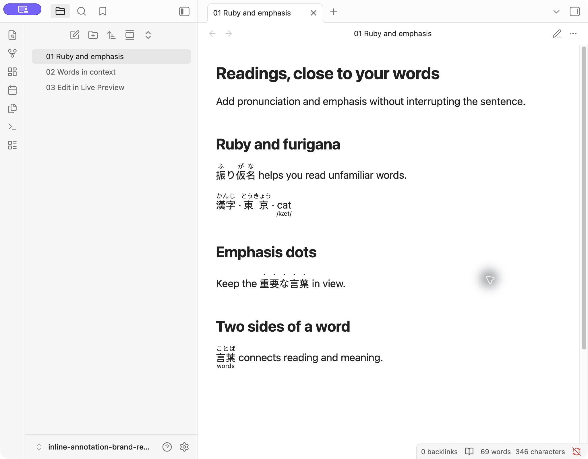
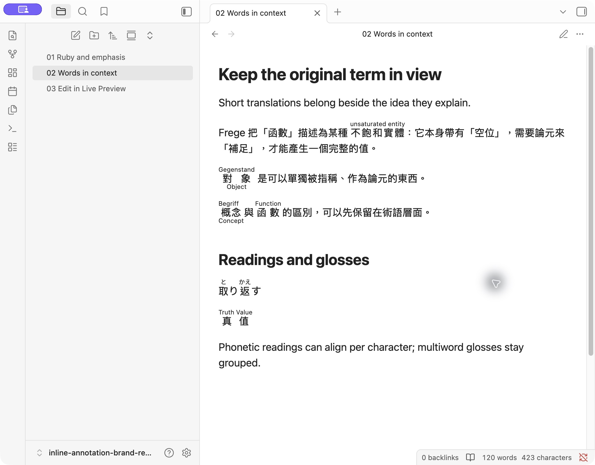
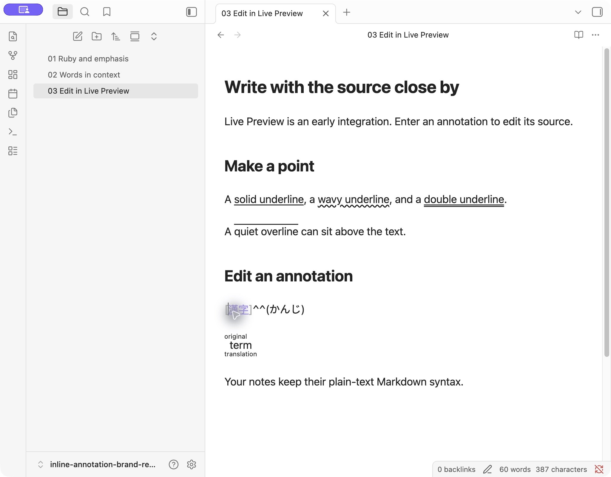

> Development and releases now live in the [Inline Annotation monorepo](https://github.com/BaksiLi/markdown-inline-annotation). This integration is maintained in `plugins/obsidian`. Run workspace commands from the repository root; see the [root guide](../../README.md).

# Inline Annotation (Ruby)


Add pronunciation, translations, and emphasis alongside your text using the
**Inline Annotation syntax**. Render ruby/furigana, annotations above and below,
bouten emphasis dots, overlines, and underlines in Obsidian.

```markdown
[漢字]^^(かんじ)
[base]^^(over)^_(under)
[重要]^^(..)^_(.~)
```

The plugin supports Reading view and an early Live Preview replacement widget.
Both use the model from
[`markdown-it-inline-annotation/core`](https://github.com/BaksiLi/markdown-inline-annotation/tree/main/packages/markdown-it).

## In Obsidian



Keep original terms and translations close to the sentence:



Live Preview renders annotations while you write and reveals their source when
the cursor enters an expression:



These are native Obsidian 1.12.7 captures using the default light theme.
The [source notes](examples/screenshots/) are included for repeatable captures.

## Behavior

| Surface | Support |
| --- | --- |
| Reading view | yes |
| Live Preview | prototype; reveals source while editing the expression |
| Source mode | original Markdown source |
| Commands and settings | not yet |
| Network access or external resources | none |

The adapter uses conservative `spaceAlignment: "auto"`: phonetic readings such
as `[取り返す]^^(と り かえ す)` align per character, while glosses such as
`[真值]^^(Truth Value)` stay grouped.

## Host Boundaries

Obsidian parses Markdown before Reading-view postprocessors run. The adapter:

- renders complete expressions inside a plain or consistently formatted run;
- may join adjacent plain text nodes and attribute-free spans;
- does not join across emphasis, highlight, link, code, or another semantic
  boundary;
- skips existing links, code, preformatted blocks, ruby elements, scripts,
  styles, textareas, and `data-inline-annotation-ignore` elements.

Annotation slots are plain text. Rich Markdown such as
`[term]^^(**bold gloss**)` is intentionally not reconstructed after Obsidian has
split it into semantic DOM nodes. Preserving the source and formatting is safer
than silently flattening them to form an annotation.

Live Preview has a separate CodeMirror integration because it operates on
source ranges rather than rendered DOM. See
[docs/live-preview-notes.md](./docs/live-preview-notes.md) for its current
tradeoffs.

## Styling

The bundled stylesheet exposes a small customization surface:

```css
body {
  --ia-rt-font-size: 0.65em;
  --ia-rt-line-height: 1;
  --ia-underline-offset: 0.15em;
}
```

## Development

Run from the monorepo root:

```sh
npm ci
npm run build --workspace packages/markdown-it
npm run check --workspace plugins/obsidian
```

The root `release:prepare` command synchronizes the manifest, versions map, and
update metadata. All products release from one bare version tag; see the
[root release guide](../../README.md#release).
The check covers shared fixtures, Live Preview ranges, and package safety rules.
The core is bundled; Obsidian and CodeMirror remain external.

To test the runtime files in a vault:

```sh
npm run install:vault --workspace plugins/obsidian -- "/path/to/Vault" --clean --enable --examples
```

Then reload Obsidian or disable and re-enable the plugin. The installer copies
only `main.js`, `manifest.json`, `versions.json`, and `styles.css`; `--examples`
also installs the maintained smoke and showcase notes.

- [examples/obsidian-smoke.md](./examples/obsidian-smoke.md): focused smoke test.
- [examples/obsidian-showcase.md](./examples/obsidian-showcase.md): broader visual pass.

## Ecosystem

- [Inline Annotation spec and core](https://github.com/BaksiLi/markdown-inline-annotation/tree/main/packages/markdown-it)
- [Inline Annotation for VS Code](https://marketplace.visualstudio.com/items?itemName=baksili.vscode-inline-annotation)
- [Logseq reference plugin](https://github.com/BaksiLi/markdown-inline-annotation/tree/main/plugins/logseq)
- [Original proposal](https://blog.baksili.codes/markdown-ruby)

## Safety

Generated DOM is built with DOM APIs. User-authored text is escaped by the
shared core, and the plugin loads no scripts or remote resources.

## License

MIT
